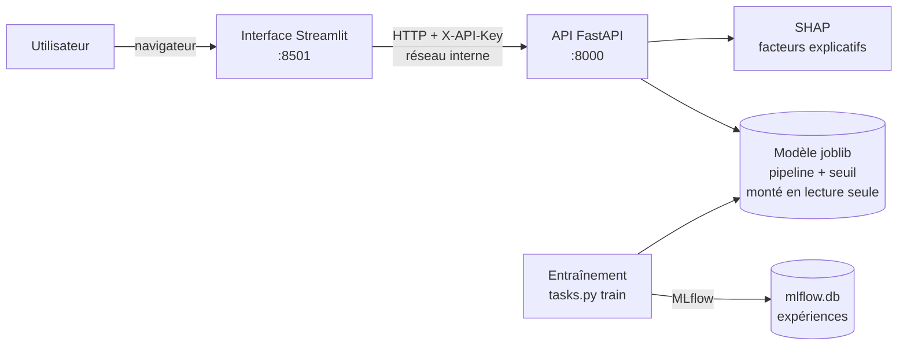
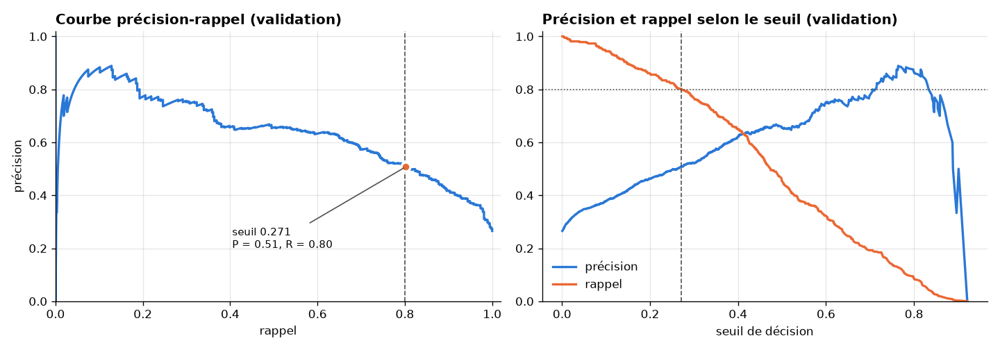
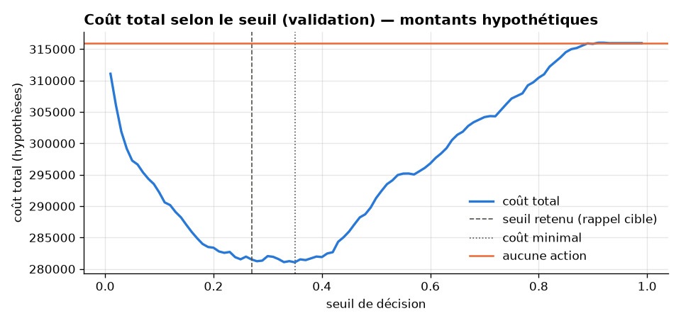
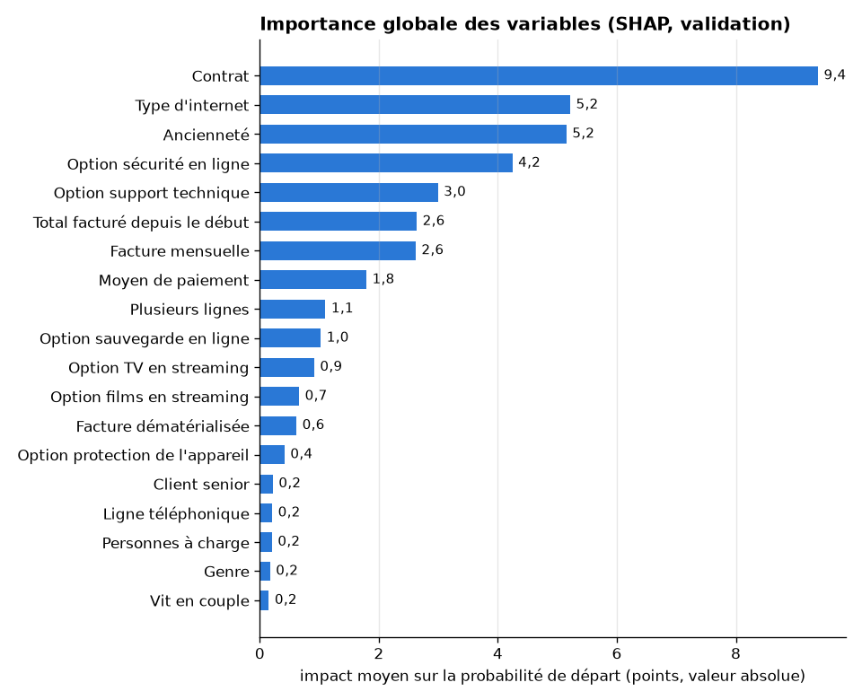

# ChurnGuard

[](https://github.com/zakaech/churnguard/actions/workflows/ci.yml)

Prédiction **et explication** du risque de départ (churn) des clients d'un opérateur télécom :
un modèle de machine learning, une API FastAPI et une interface Streamlit, conteneurisés et
testés en intégration continue.

| Résultat final (test, évalué une seule fois) | Valeur |
|---|---|
| Rappel (part des départs détectés) | **80,2 %** (objectif : ≥ 80 %) |
| Précision (part des alertes justifiées) | 51,4 % |
| ROC-AUC / PR-AUC | 0,844 / 0,653 |
| Modèle | Random Forest réglé, seuil 0,2712 choisi sur la validation |

## Problème métier

Un opérateur télécom perd chaque mois une partie de ses clients ; dans ce jeu de données,
**26,5 %** des clients sont partis. Retenir un client coûte moins cher qu'en conquérir un
nouveau, mais une offre de fidélisation envoyée à tout le monde coûte cher. ChurnGuard
répond à deux questions :

1. **Qui risque de partir ?** Une probabilité de départ, une décision (signalé ou non) et un
   niveau de risque (faible / moyen / élevé) pour chaque client.
2. **Pourquoi ?** Les 5 facteurs principaux de chaque prédiction (SHAP), en langage clair :
   « Contrat : au mois — augmente le risque (+11,6 points) ».

L'objectif métier retenu : **détecter au moins 80 % des départs** en limitant au maximum les
offres envoyées à tort.

## Lancement en une commande (Docker)

Prérequis : Docker, et le modèle entraîné dans `models/` (voir « Stockage du modèle »).

```bash
cp .env.example .env          # puis définir CHURNGUARD_API_KEY (clé d'API)
docker compose up --build     # API + interface
```

- Interface : http://127.0.0.1:8501
- API (documentation Swagger) : http://127.0.0.1:8000/docs — bouton « Authorize » pour la clé
- Option : `docker compose --profile mlflow up --build` ajoute l'interface MLflow (port 5000)

## Architecture



- L'interface **n'a jamais accès au modèle** : elle appelle l'API.
- Le modèle (prétraitement + Random Forest + seuil) est un seul fichier, chargé une fois au
  démarrage de l'API.
- L'entraînement, MLflow et les notebooks restent hors des images Docker.

## Captures d'écran

> Emplacements prévus — captures à ajouter (dossier `docs/screenshots/`).

| Page « Client » | Page « Import CSV » | Page « Analyse » | Swagger UI |
|---|---|---|---|
| `docs/screenshots/client.png` | `docs/screenshots/import_csv.png` | `docs/screenshots/analyse.png` | `docs/screenshots/swagger.png` |

## Données

- Source : **Telco Customer Churn** (IBM), publié sur Kaggle :
  [kaggle.com/datasets/blastchar/telco-customer-churn](https://www.kaggle.com/datasets/blastchar/telco-customer-churn)
  (7 043 clients, 21 colonnes).
- Licence affichée sur la page Kaggle : « Data files © Original Authors » (relevé le
  5 novembre 2026). La page ne précise rien sur la redistribution des données ni sur la
  publication d'un modèle dérivé.
- **Ce dépôt ne contient aucune donnée réelle.** Le fichier source est téléchargé localement
  (`python tasks.py download`) et n'est jamais versionné. Les tests et la CI utilisent un
  échantillon **synthétique** (`tests/data/sample.csv`, 300 clients inventés par
  `scripts/make_synthetic_sample.py`). Les notebooks et `reports/` ne montrent que des
  statistiques agrégées et des graphiques ; aucune ligne ni aucun identifiant de client réel
  n'y figure. Les exemples de clients individuels sont fictifs.
- Le modèle entraîné, dérivé des données, n'est pas versionné non plus.

## Installation (développement)

```bash
py -3.12 -m venv .venv
.venv\Scripts\activate          # Linux/macOS : source .venv/bin/activate
pip install -r requirements-dev.txt -c constraints.txt
pip install -e .
```

## Commandes

```bash
python tasks.py download        # télécharge les données (API Kaggle, ou instructions manuelles)
python tasks.py data            # nettoie et découpe (train/val/test) vers data/processed/
python tasks.py notebook        # ré-exécute les notebooks (exploration, résultats)
python tasks.py train-baseline  # entraîne les baselines, métriques sur la validation
python tasks.py train           # compare, règle, choisit modèle + seuil (refusé si le test a été évalué)
python tasks.py evaluate-test   # évaluation UNIQUE sur le test (refuse de se relancer)
python tasks.py explain-global  # importance globale SHAP (validation) -> reports/
python tasks.py explain --customer-id <ID>  # facteurs de risque d'un client (affichage)
python tasks.py api             # API FastAPI (http://127.0.0.1:8000/docs)
python tasks.py ui              # interface Streamlit (http://127.0.0.1:8501), l'API doit tourner
python tasks.py mlflow-ui       # interface MLflow (http://127.0.0.1:5000)
python tasks.py test            # tests pytest
python tasks.py lint            # ruff
```

## Démarche de modélisation

Tous les chiffres ci-dessous proviennent de l'exécution des commandes listées plus haut
(`reports/` contient les fichiers bruts correspondants).

1. **Découpage stratifié 60 / 20 / 20** (train 4 225, validation 1 409, test 1 409 clients ;
   26,5 % de départs dans chaque partie), fait avant toute analyse.
2. **Prétraitement dans un pipeline** (imputation, normalisation, one-hot), appris sur le
   train uniquement.
3. **Comparaison en validation croisée stratifiée (5 plis, train uniquement)** de 3 modèles
   (régression logistique, Random Forest, XGBoost) × 3 stratégies de déséquilibre
   (aucune, poids des classes, SMOTENC), puis recherche aléatoire d'hyperparamètres
   (25 combinaisons) pour chaque modèle. Critère : PR-AUC. Toutes les expériences sont
   journalisées dans MLflow.
4. **Choix du modèle et du seuil sur la validation**, selon une règle fixée **avant** de voir
   les résultats : seuil = précision maximale parmi les seuils donnant un rappel ≥ 80 % ;
   modèle = meilleure précision à ce seuil.
5. **Évaluation unique sur le test** du modèle et du seuil retenus.

### Baselines (validation, seuil 0,5)

| Modèle | Exactitude | Précision | Rappel | F1 | ROC-AUC | PR-AUC |
|---|---|---|---|---|---|---|
| Classe majoritaire | 0.735 | 0.000 | 0.000 | 0.000 | 0.500 | 0.265 |
| Régression logistique | 0.802 | 0.657 | 0.532 | 0.588 | 0.836 | 0.642 |

La classe majoritaire atteint 73,5 % d'exactitude sans détecter un seul départ :
l'exactitude est trompeuse quand les classes sont déséquilibrées.

### Comparaison en validation croisée (PR-AUC, moyenne ± écart-type sur 5 plis)

| Modèle | Aucune | Poids des classes | SMOTENC | Après recherche |
|---|---|---|---|---|
| Régression logistique | 0.666 ± 0.025 | 0.665 ± 0.026 | 0.651 ± 0.030 | 0.668 ± 0.024 (aucune) |
| Random Forest | 0.622 ± 0.005 | 0.616 ± 0.010 | 0.601 ± 0.009 | 0.675 ± 0.012 (aucune) |
| XGBoost | 0.619 ± 0.016 | 0.624 ± 0.008 | 0.620 ± 0.013 | 0.677 ± 0.015 (poids) |

- Le rééquilibrage (poids des classes, SMOTENC) n'améliore pas le classement des clients :
  il décale surtout les probabilités, ce que le choix du seuil fait déjà.
- Random Forest et XGBoost gagnent surtout à être régularisés (arbres moins profonds,
  feuilles plus grandes). Random Forest final : 400 arbres, `max_depth=12`,
  `min_samples_leaf=20`, `max_features=0.3`.

### Choix du modèle et du seuil (validation)

| Modèle | Seuil | Précision | Rappel | F1 | Départs détectés | Fausses alertes | Départs manqués |
|---|---|---|---|---|---|---|---|
| Régression logistique | 0.243 | 0.499 | 0.802 | 0.615 | 300 | 301 | 74 |
| **Random Forest** | **0.271** | **0.508** | 0.802 | 0.622 | 300 | 291 | 74 |
| XGBoost | 0.489 | 0.508 | 0.805 | 0.623 | 301 | 292 | 73 |

**Les trois modèles sont équivalents à un client près.** Random Forest (300 / 591 = 0,50761)
devance XGBoost (301 / 593 = 0,50759) d'un client ; la régression logistique fait environ
10 fausses alertes de plus sur 1 409 clients, et les écarts de PR-AUC en validation croisée
sont inférieurs à l'écart-type entre plis.

**Pourquoi avoir tout de même appliqué la règle (Random Forest) ?** La règle de sélection a
été fixée avant de voir les résultats. La modifier après coup pour préférer un autre modèle
reviendrait à ajuster nos choix sur la validation, et à présenter une estimation trop
optimiste. Respecter la règle garde la démarche honnête ; l'équivalence des modèles est
documentée ici. La régression logistique, plus simple et plus lisible, aurait été un choix
tout aussi défendable s'il avait été décidé avant les résultats.



**Seuil retenu : 0,2712.** Le seuil par défaut de 0,5 ne détecte que 45 % des départs
(169 sur 374 en validation) ; l'objectif métier est d'en détecter au moins 80 %, en limitant
au maximum les offres de fidélisation envoyées à tort.

### Résultat final sur le test (évaluation unique)

Random Forest, seuil 0,2712, fixé sur la validation puis non modifié :

| Précision | Rappel | F1 | ROC-AUC | PR-AUC | Exactitude |
|---|---|---|---|---|---|
| 0.514 | 0.802 | 0.626 | 0.844 | 0.653 | 0.746 |

Matrice de confusion sur 1 409 clients : 300 départs détectés, 74 départs manqués,
284 fausses alertes, 751 clients fidèles correctement non signalés. Le rappel visé (80 %)
est atteint sur le test (80,2 %) ; environ une alerte sur deux correspond à un vrai départ.
Les résultats du test sont proches de ceux de la validation : pas de signe de surajustement
au choix du seuil.

### Analyse de coût (illustrative)

> ⚠️ **Les montants sont des hypothèses, pas des données de l'opérateur.** Ils servent
> uniquement à illustrer l'intérêt d'un seuil adapté. Le seuil retenu reste celui fixé par
> l'objectif de rappel, pas par ce calcul.

Hypothèses (en unités monétaires du jeu de données, à partir de la facture mensuelle
médiane du train, 70,40) : un client perdu coûte 12 mois (844,80) ; une offre de
fidélisation coûte 1 mois (70,40) ; 30 % des clients ciblés restent grâce à l'offre.

```
coût = FN × coût_client_perdu
     + TP × (1 − taux_succès) × coût_client_perdu
     + (TP + FP) × coût_offre
```

| Politique | Coût (validation) | vs aucune action | Coût (test) | vs aucune action |
|---|---|---|---|---|
| Aucune action | 315 955 | — | 315 955 | — |
| Seuil 0,5 | 291 287 | −7,8 % | 289 161 | −8,5 % |
| **Seuil retenu (0,271)** | **281 530** | **−10,9 %** | **281 037** | **−11,1 %** |
| Seuil de coût minimal* | 281 065 (0,35) | −11,0 % | 280 009 (0,30) | −11,4 % |

\* Indicatif seulement : sur le test, ce seuil est calculé a posteriori et n'est pas utilisé.



Avec ces hypothèses, la courbe de coût est presque plate entre les seuils 0,25 et 0,40 : le
seuil fixé par le rappel cible est à 0,2 % (validation) du coût minimal, alors que le seuil
0,5 coûte nettement plus. Avec d'autres hypothèses (coût de l'offre, taux de succès), le
seuil optimal changerait : c'est un paramètre à fixer avec le métier.

## Explicabilité (SHAP)

Pour chaque client, **SHAP** répartit l'écart entre sa probabilité de départ et la probabilité
moyenne (0,265) entre les variables. Avec ce Random Forest, les contributions sont exprimées en
**points de probabilité** et s'additionnent exactement (valeur de base + somme des contributions
= probabilité prédite ; écart maximal mesuré de l'ordre de 10⁻¹⁵). Les colonnes one-hot d'une
même variable sont regroupées pour revenir aux 19 variables d'origine.

### Importance globale (validation)



- **Le contrat domine** (9,4 points d'impact moyen) : le contrat au mois ajoute en moyenne
  9,8 points au risque, le contrat de deux ans en retire 10,6.
- Suivent le type d'internet (5,2), l'ancienneté (5,2), les options sécurité en ligne (4,2) et
  support technique (3,0), puis les montants facturés (2,6 chacun).
- L'ancienneté augmente fortement le risque pendant les 6 premiers mois (+9,2 points en
  moyenne) et le diminue au-delà de 18 mois ; une facture mensuelle supérieure à 80 l'augmente.
- Les variables démographiques (genre, couple, senior, personnes à charge) pèsent moins de
  0,3 point en moyenne.

Le détail (beeswarm, courbes de dépendance, graphiques waterfall) est dans
[notebooks/02_resultats.ipynb](notebooks/02_resultats.ipynb).

### Explication d'un client

`ChurnExplainer.top_factors` renvoie les **5 facteurs les plus importants, dans les deux sens**,
avec l'impact en points de probabilité. Exemple sur un **client fictif** (contrat au mois,
2 mois d'ancienneté, fibre, chèque électronique) :

```
FICTIF-A — probabilité 75,7 % -> signalé (seuil 27,1 %)
  1. Contrat : au mois — augmente le risque (+11,6 points)
  2. Ancienneté : 2 mois — augmente le risque (+9,2 points)
  3. Type d'internet : fibre optique — augmente le risque (+7,2 points)
  4. Option sécurité en ligne : non — augmente le risque (+5,8 points)
  5. Total facturé depuis le début : 171,00 — augmente le risque (+4,2 points)
```

Pour un vrai client du jeu de données : `python tasks.py explain --customer-id <ID> --split test`
(sortie affichée seulement, rien n'est enregistré).

### Limites

- SHAP explique **le modèle**, pas la réalité : aucune lecture causale.
- `tenure` et `TotalCharges` sont très corrélées (Spearman 0,90) : le modèle peut répartir leur
  effet entre les deux de façon arbitraire ; il faut les lire ensemble.
- Les contributions en points de probabilité sont exactes pour ce Random Forest ; un autre type
  de modèle (par exemple XGBoost, dont les sorties sont en log-odds) demanderait une autre
  approche.

## Niveaux de risque

| Niveau | Règle | Validation : clients | Départs réels |
|---|---|---|---|
| **élevé** | probabilité ≥ 0,2712 (seuil du modèle) | 591 | 300 (50,8 %) |
| **moyen** | 0,05 ≤ probabilité < 0,2712 | 461 | 66 (14,3 %) |
| **faible** | probabilité < 0,05 | 357 | 8 (2,2 %) |

- « élevé » correspond **exactement** aux clients signalés par le seuil : c'est la même
  comparaison (probabilité ≥ seuil), et le seuil est lu dans le modèle sauvegardé.
- La limite 0,05 entre « faible » et « moyen » a été choisie sur la **validation uniquement**
  (le test n'a pas servi) : sous 0,05, le taux de départ observé est très bas et stable
  (0,8 à 3,1 % selon la tranche) ; juste au-dessus, il passe à environ 10 % puis reste entre
  10 et 14 % jusqu'à 0,20. Le groupe « moyen » contient 89 % des départs non signalés par le
  seuil (66 sur 74) : c'est une cible naturelle pour des actions plus légères.
- **Limites** : les effectifs par tranche sont petits (63 clients entre 0,05 et 0,08), donc la
  position exacte de la rupture est approximative ; et les probabilités du Random Forest ne
  sont pas calibrées (0,10 ne veut pas dire « 10 % de chances de partir »). C'est pourquoi la
  limite est justifiée par les taux de départ observés, pas par la valeur de la probabilité.

## API (FastAPI)

```bash
python tasks.py api      # http://127.0.0.1:8000 — documentation interactive : /docs
```

Le modèle est chargé une seule fois au démarrage (chemin : variable d'environnement
`CHURNGUARD_MODEL_PATH`, sinon celui de `config.yaml`).
Si `CHURNGUARD_API_KEY` est définie, toutes les routes sauf `/health` exigent l'en-tête
`X-API-Key` (erreur 401 sinon).

| Méthode | Route | Rôle |
|---|---|---|
| GET | `/health` | état du service, modèle, version, seuil, limites |
| GET | `/model/info` | performances (validation, test), règle de seuil, importance SHAP |
| POST | `/predict` | un client → probabilité, décision, niveau de risque, 5 facteurs (SHAP) |
| POST | `/predict/batch` | plusieurs clients (JSON) ; `include_factors=false` par défaut |
| POST | `/predict/batch/csv` | fichier CSV au format brut ; `include_factors=false` par défaut |

**Entrée** : un client au **format brut du fichier Telco** (mêmes colonnes ; `SeniorCitizen` en
0/1 ; `TotalCharges` peut être vide pour un client d'ancienneté 0). L'API applique le même
nettoyage que l'entraînement (`clean_features`). Sont refusés (erreur 422) : champ manquant ou
en trop, modalité inconnue, valeurs hors bornes, `TotalCharges` vide avec une ancienneté > 0,
et **combinaisons de services incohérentes** (par exemple des options internet sans internet).
Pour un CSV, les colonnes en trop (comme `Churn`) sont ignorées et listées dans la réponse ;
une ligne invalide est signalée avec son numéro.

Exemple (client fictif, réponse réelle de `POST /predict`) :

```json
{
  "customerID": "FICTIF-A",
  "churn_probability": 0.757,
  "churn_predicted": true,
  "risk_level": "élevé",
  "threshold": 0.2712,
  "top_factors": [
    {"label": "Contrat", "value_label": "au mois", "impact_points": 11.6, "direction": "hausse",
     "text": "Contrat : au mois — augmente le risque (+11,6 points)"},
    "… 4 autres facteurs"
  ]
}
```

**Temps de réponse mesurés** (HTTP local, poste de développement) : `/predict` ≈ 0,1 s ;
lot de 2 000 clients ≈ 0,3 s sans facteurs, ≈ 17-18 s avec facteurs ; lot de 500 clients avec
facteurs ≈ 4,6 s. D'où deux limites par lot : **2 000 clients sans facteurs, 500 avec**
(au-delà : erreur 413).

## Interface (Streamlit)

L'interface appelle l'API (adresse : `API_URL`, clé : `CHURNGUARD_API_KEY`, côté serveur ;
la clé n'est jamais envoyée au navigateur).

- **Client** : formulaire en français ; les options internet et la ligne multiple se
  verrouillent automatiquement quand le service correspondant est absent (combinaisons
  incohérentes impossibles). Résultat : probabilité, niveau de risque (icône + libellé),
  graphique et liste des 5 facteurs.
- **Import CSV** : fichier au format brut ; découpé automatiquement en lots dans les limites
  de l'API ; tableau trié par risque décroissant, téléchargeable ; erreurs affichées avec le
  numéro de ligne du fichier d'origine.
- **Analyse** : performances (validation, test), importance globale SHAP, répartition des
  risques du dernier fichier importé.

## Sécurité

- **Clé d'API** : si `CHURNGUARD_API_KEY` est définie, les routes de prédiction et
  `/model/info` exigent l'en-tête `X-API-Key` (comparaison à temps constant) ; `/health`
  reste ouvert. `docker compose` refuse de démarrer sans clé.
- **API non exposée** : dans `docker-compose.yml`, l'interface joint l'API par le réseau
  interne (`http://api:8000`) ; les ports ne sont publiés que sur `127.0.0.1`.
- **Images** : base `python:3.12-slim`, utilisateur non-root, modèle monté en lecture seule,
  `.env` et données exclus du contexte de construction.
- **Modèle** : un fichier joblib est un *pickle* (le charger exécute du code) : il n'est
  installé depuis une release que si son empreinte SHA-256 correspond (voir ci-dessous).

## Stockage du modèle

Le modèle final (`models/churnguard_model.joblib`, 5,5 Mo) et ses métadonnées ne sont pas
versionnés dans Git. Choix retenu : une **release GitHub** (`model-v1.0.0`) contenant le
modèle et `metadata.json` ; `python scripts/fetch_model.py` les télécharge et **refuse le
modèle si son empreinte SHA-256 diffère** de celle enregistrée dans `config.yaml`.
La release n'est pas publiée : la licence affichée ne précise pas si un modèle dérivé peut
être diffusé. En local,
`docker compose` monte `./models` en lecture seule.

## Intégration continue (GitHub Actions)

À chaque push et pull request (`.github/workflows/ci.yml`), **sans Kaggle ni vrai modèle** :

1. **lint** : `ruff check` et `ruff format --check` ;
2. **tests** : `pytest` (échantillon synthétique et petits modèles entraînés pendant les
   tests) ; le job vérifie qu'aucune donnée réelle ni aucun modèle n'est présent ;
3. **docker** : construction des deux images, entraînement d'un modèle de test sur
   l'échantillon synthétique, puis vérification de l'API en conteneur (santé, refus sans
   clé, prédiction avec clé) et de l'interface.

Les tests passent aussi dans un clone propre du dépôt, sans `data/` ni `models/`.

## Mesures (images et mémoire)

Mesures locales (Docker Desktop, poste de développement) :

| | API | Interface |
|---|---|---|
| Taille de l'image | 685 Mo | 780 Mo |
| Mémoire au repos | 153 Mo | 52 Mo |
| Mémoire en pic (lots de 2 000 sans facteurs, 500 avec) | 177 Mo | 63 Mo* |

\* L'interface n'a été sollicitée que par quelques appels, pas par de vrais utilisateurs.
Dans le conteneur, un lot de 500 clients avec facteurs SHAP prend 11 à 12 s (4,6 s hors
Docker) : le calcul SHAP dépend fortement du processeur disponible.

## Déploiement (préparé, non déployé)

Plateforme retenue : **Hugging Face Spaces** (SDK Docker, matériel gratuit « CPU Basic :
2 vCPU, 16 GB » selon la page tarifs consultée le 31/10/2026). L'image combinée
`docker/space.Dockerfile` lance l'API sur `127.0.0.1:8000` (**non joignable depuis
l'extérieur**, vérifié : connexion refusée depuis un autre conteneur) et l'interface sur le
seul port exposé (7860). Au démarrage, le modèle est téléchargé depuis la release GitHub et
**refusé si son SHA-256 ne correspond pas** ; sans release, le conteneur s'arrête avec un
message clair. Étapes : [deploy/huggingface/README.md](deploy/huggingface/README.md).

Le déploiement n'est pas effectué : la licence affichée ne précise pas si une démo et un
modèle dérivés des données peuvent être publiés.

## Limites du projet

- **Données** : un jeu public, ancien et de taille modeste (7 043 clients), sans dimension
  temporelle ; le modèle n'a jamais été confronté à des données d'un vrai opérateur.
- **Modèle** : trois modèles équivalents à un client près ; probabilités non calibrées
  (0,10 ne signifie pas « 10 % de chances de partir ») ; pas de suivi de la dérive des
  données en production.
- **Explications** : SHAP explique le modèle, pas les causes réelles du départ ; variables
  corrélées (`tenure` et `TotalCharges`) à lire ensemble.
- **Coûts** : l'analyse de coût repose sur des montants hypothétiques.
- **API et interface** : pas de limitation du débit, une seule clé partagée, interface sans
  authentification propre ; calcul SHAP lent sur de petites machines.
- **Licence** : la page Kaggle affiche « Data files © Original Authors », sans préciser la
  redistribution ni les modèles dérivés ; le modèle et une démo ne sont donc pas publiés.
